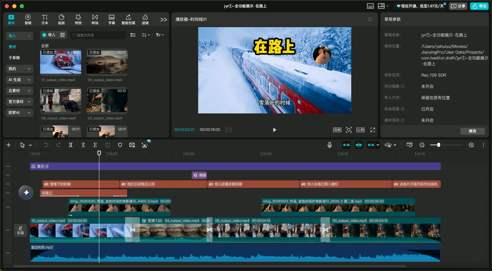

<div align="center">

# Easy JianYing

**Tell your AI what to cut. Get a real, editable JianYing (剪映) project back.**

Transitions, masks, keyframes, subtitles, beat-sync, talking-head rough cuts — all as native JianYing tracks you can drag, tweak and export.

[中文](README.md) · [Quick start](#quick-start) · [How it works](docs/how-it-works.md) · [The 11.7 watershed](#jianying-117-is-a-watershed)


<p>A JSON plan became a draft, which <b>JianYing 11.7 opened and exported itself</b>.<br>The small circle at the top right is a deliberate picture-in-picture (circle mask + zoom-in) to show the feature, not a glitch.</p>

</div>

---

## Why a draft, not a finished video

AI-made videos are often one or two details away from done: a typo in a subtitle, a shot half a second too long, music a bit too loud.

With a finished video, every fix means going back to the AI, regenerating and re-rendering — more waiting, more compute, and no guarantee the result is what you wanted. With a JianYing draft, you open JianYing, fix the subtitle, trim the clip and export.

| Fix one typo | Finished video | JianYing draft |
|---|---|---|
| How | Regenerate and re-render | Double-click the subtitle in JianYing |
| Wait | Another full render | Seconds |
| Compute | Spent again | None |

> **AI writes the edit plan → we generate a native JianYing draft → you open it and fine-tune.**

<div align="center"></div>

## What it does

| | Feature | What it means |
|---|---|---|
| 🎬 | **Generate drafts** | Multi-track, chop, speed, transitions, masks, keyframes, PiP, text, subtitles, stickers, effects, filters, music fades, images/GIF |
| ✂️ | **Talking-head rough cut** | Cuts dead air, fillers, stutters and false starts; then an agent drops the sentence you said twice |
| 💬 | **Auto subtitles** | Local speech recognition (nothing uploaded) → JianYing's native caption track |
| 🥁 | **Beat sync** | Detects the beat, cuts footage on it, adds JianYing beat markers |
| 📦 | **Batch** | One template × one spreadsheet = N drafts |
| 🎨 | **Auto picks** | `"auto"` transitions / animations / fonts, chosen from your own habits |
| 📤 | **Export** | JianYing renders the final video itself |
| 🔄 | **Self-adapting** | One command learns a new JianYing version after an update |

## JianYing 11.7 is a watershed

JianYing drafts are encrypted. For years the community's trick was not to break the cipher but to **ask JianYing's own built-in codec to lock and unlock** files. In 11.7 the codec is still there, but the key now lives only inside the running app. We chose **not** to dig that key out.

Instead we hand JianYing an unlocked draft and let it lock the draft itself. It accepts it.

| Your JianYing | Create drafts | Read / edit existing drafts |
|---|:---:|:---:|
| 5.x and older | ✅ | ✅ |
| 6.0 – 11.6 | ✅ (auto encrypt) | ✅ |
| **11.7+** | ✅ (plaintext; JianYing encrypts on save) | ❌ |

The tool detects your version automatically.

## Quick start

macOS + JianYing Pro, Python 3.10+, ffmpeg, Xcode command line tools.

```bash
git clone https://github.com/YeJe-cpu/easy-jianying && cd easy-jianying
pip install -e '.[asr,fonts]'
jyr doctor
./tools/make_fixtures.sh examples/media
jyr build examples/showcase.plan.json --out /tmp/jyr-demo --publish --name "my first AI draft"
```

Quit JianYing before publishing; the new draft appears first on its home screen. Plan reference: [docs/plan-format.md](docs/plan-format.md). Agent skills: [`skills/`](skills/).

## How we checked it

1. **JianYing verifies every feature.** It opens our draft and re-saves it in its own format, and we diff the result track by track. Then real footage gets checked by a human eye and exported.
2. **Effects you don't have get downloaded by JianYing.** We ship 375 resource cards (transitions, masks, animations, filters, effects, stickers, fonts). We tested it: delete the cache, and JianYing downloads the effect or font again by its ID.
3. **The rough cut is graded against a human editor.** On a 316 s raw take, the human cut was 232 s. Rules alone gave 250 s and kept 99% of what the human kept; one agent pass got it to 242 s.
4. **The beat sync is frame-accurate.** On a metronome at 90–150 BPM: tempo error ≤1.5%, beat position off by 2 ms on average and 5 ms at most.
5. **Built for agents.** Times are in seconds, clips chain automatically, resources go by their UI names, and errors list the options that are available.

## Limits

macOS JianYing Pro only, tested on an Intel Mac with JianYing 11.6 and 11.7. Apple Silicon should work but hasn't been tested; Windows and CapCut are untested. On 11.7+ the tool writes drafts but cannot read existing ones. Not yet supported: crop, chroma key, color grading, curve speed, styled text and audio effects. **Unofficial; not affiliated with ByteDance.** JianYing's terms of use apply.

## Credits

[pyJianYingDraft](https://github.com/GuanYixuan/pyJianYingDraft), [jy-draftc](https://github.com/wenshui330/jy-draftc), [capcut-cli](https://github.com/renezander030/capcut-cli), Dan Ellis's beat tracking and [faster-whisper](https://github.com/SYSTRAN/faster-whisper). Thanks also to Yichen's (mcncarl) jianying-headless: we first used and adapted it locally, and after it was taken down we rewrote this project from scratch. It contains none of that project's code or data.

## License

[PolyForm Noncommercial 1.0.0](LICENSE.md). Free for learning, research and other non-commercial use. Commercial use (paid courses, paid services, client work) needs permission from the author.

## Contact

X [@leaf_sanren](https://x.com/leaf_sanren) for chats and feedback (or open an issue); commercial licensing: [aiesecxuanli@gmail.com](mailto:aiesecxuanli@gmail.com). Also by the author: [SeeCut](https://github.com/YeJe-cpu/SeeCut).
