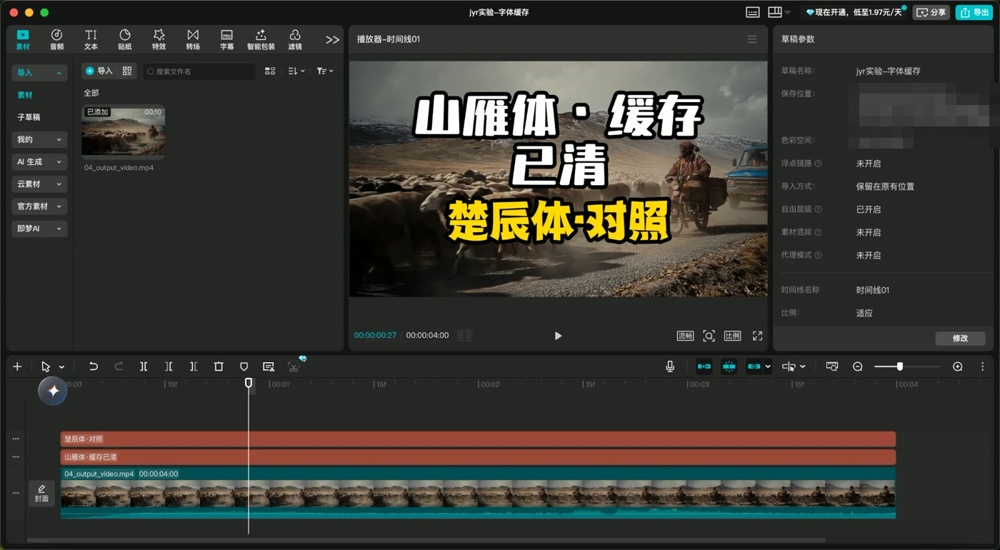
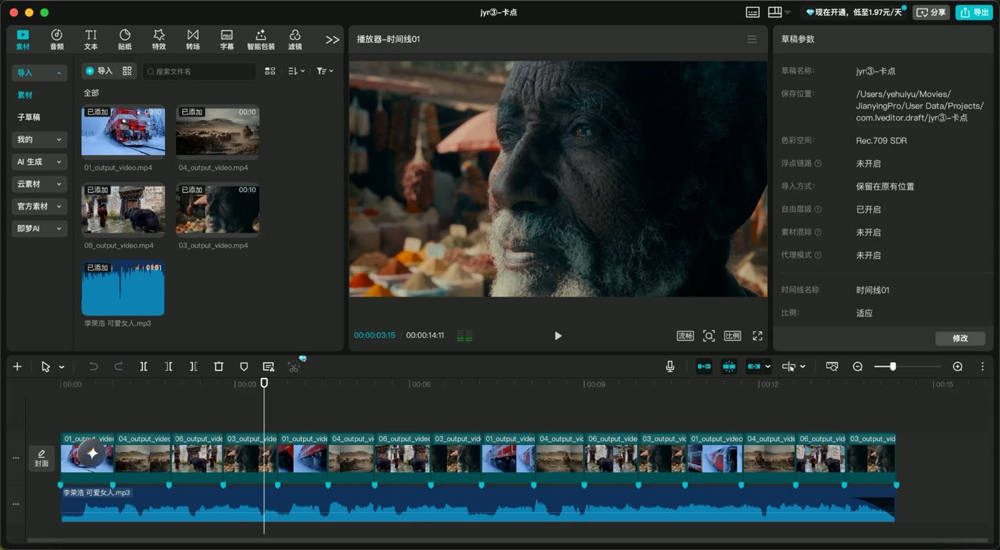

<div align="center">

# Easy 剪映

**让 AI 把剪辑做成剪映草稿，你在剪映里接着改。**

转场、蒙版、关键帧、字幕、卡点、口播粗剪，都会变成剪映里正常的轨道和片段，可以拖、可以改，改完直接导出。

[English](README.en.md) · [三分钟上手](#三分钟上手) · [它是怎么做到的](docs/how-it-works.md) · [剪映 11.7 分水岭](#剪映-117-是一道分水岭) · [CapCut 国际版](#capcut-国际版)


<p>这段画面由一份 JSON 计划生成草稿，再由<b>剪映 11.7 自己打开、导出</b>。<br>右上角的小圆圈是特意加的画中画（圆形蒙版 + 放大入场），用来演示功能，不是穿帮。</p>

</div>

---

## 为什么要做成草稿，而不是直接给成片

AI 剪出来的片子，常常只差一两处：字幕错了一个字，某个镜头长了半秒，音乐想再小一点。

如果拿到的是成片，改这些就得回到 AI 那边重新生成、重新渲染。片子越长，等得越久，每改一次都要再花一次算力，改完还不一定是你想要的。

如果拿到的是剪映草稿，打开剪映，点到那条字幕改掉，把片段拖短一点，导出就完了。

| 想改一个错别字 | 拿到成片 | 拿到剪映草稿 |
|---|---|---|
| 怎么改 | 让 AI 重新生成、重新渲染 | 在剪映里双击字幕，改掉 |
| 要等多久 | 再渲染一遍 | 几秒钟 |
| 算力 | 再花一次 | 不用 |

Easy 剪映做的就是这一步：**AI 写剪辑计划 → 生成剪映草稿 → 你在剪映里打开微调。** 每段素材、每条字幕、每个转场都是独立的片段，和你自己剪的工程没有区别。粗活交给 AI，细节你自己定。

<div align="center">

<p>剪映里看到的就是这样：主轨、转场、变速、画中画、标题、字幕、音乐，各在各的轨道上。</p>
</div>

## 它能做什么

| | 能力 | 具体是什么 |
|---|---|---|
| 🎬 | **生成草稿** | 多轨、切碎、变速、转场、蒙版、关键帧动画、画中画、文字、字幕、贴纸、特效、滤镜、BGM 淡入淡出、图片/GIF |
| ✂️ | **口播粗剪** | 一条 5 分钟的口播原片，自动剪掉气口、口癖、结巴和说错重来的半句；Agent 再按语义删掉"说了两遍的那句" |
| 💬 | **字幕贴语音** | 本地识别，不上传；生成剪映原生「识别字幕」，在剪映里一键改全部样式 |
| 🥁 | **卡点** | 识别音乐节拍，素材按拍切，再打上剪映原生的踩点标记 |
| 📦 | **批量** | 一个模板 × 一张表格 = N 个草稿，系列视频统一包装 |
| 🎨 | **自动调配** | 转场、动画、字体写 `"auto"`，按你自己的使用习惯来挑 |
| 📤 | **导出成片** | 让剪映自己渲染导出 |
| 🔄 | **剪映升级自适配** | 剪映一升级，一条命令学会新版本 |

<div align="center">

</div>

## 剪映 11.7 是一道分水岭

做这个项目的过程中，剪映自动升级到了 11.7，原来的做法有一半用不了了。

剪映的草稿是加密的。之前社区的做法不是破解，而是调用剪映程序里自带的加密、解密功能。

到了 11.7，这个功能还在，但它需要的密钥只在剪映自己运行时才提供，外部程序调用只能拿到空结果。这是剪映有意收紧的，所以我们没有去找这把密钥。

我们换了个做法：**写一份不加密的草稿交给剪映，剪映打开后会自己加密保存。** 实测 11.7 能正常打开、播放、导出。

| 你的剪映版本 | 生成新草稿 | 读取 / 修改已有草稿 |
|---|:---:|:---:|
| 5.x 及以前（很多老开源项目停在这里） | ✅ | ✅ |
| 6.0 – 11.6 | ✅ 自动加解密 | ✅ |
| **11.7 及以后** | ✅ 交明文，剪映自己加密 | ❌ 钥匙只在剪映手里 |

工具会自动识别剪映版本，不需要手动设置。需要修改已有草稿的，可以留在（或退回）11.6；只是往剪映里放新草稿的，用最新版就行。

## CapCut 国际版

同一份计划，加一个 `--app capcut`，就是一份 CapCut 草稿：

```bash
jyr --app capcut doctor
jyr --app capcut build examples/showcase.plan.json --out /tmp/cc-demo --publish --name "我的第一个 CapCut 草稿"
jyr --app capcut inspect "我的第一个 CapCut 草稿"     # CapCut 草稿是明文，读、导字幕、改副本都行
```

只装了一个就自动用它，不写 `--app` 也行；两个都装时默认剪映。

CapCut 的草稿本来就不加密，所以这一侧**只读写草稿文件**：不调用 CapCut 程序里的任何库，也不模拟点击它的界面。

| | 剪映 11.7+ | CapCut 9.4（实测） |
|---|:---:|:---:|
| 生成新草稿、放到首页 | ✅ | ✅ |
| 读取 / 导出字幕 / 改副本 | ❌ | ✅ |
| `jyr export` 导出成片 | ✅（驱动剪映界面） | ❌ 在 CapCut 里自己点导出 |
| 内置资源 | 375 个常用资源 | **只放 CapCut 标记为免费的**，目前是 CapCut 自带字体 |

CapCut 的资源编号和剪映不完全一样，所以它有自己的资源目录：在 CapCut 里用过一次的转场、动画、字体，`jyr --app capcut catalog scan` 一扫就能用。扫描时会读每个草稿里的 `key_value.json`，区分免费和 Pro：`"auto"` 只挑免费的，计划里点名用了 Pro 资源会给出提醒；`catalog list --free` 只列免费的。

## 三分钟上手

**你需要**：Mac + 剪映专业版、Python 3.10+、ffmpeg、Xcode 命令行工具。

```bash
git clone https://github.com/YeJe-cpu/easy-jianying && cd easy-jianying
pip install -e '.[asr,fonts]'          # 只生成草稿的话 pip install -e . 就够
jyr doctor                             # 检查剪映版本，状态应为 ok

./tools/make_fixtures.sh examples/media
jyr build examples/showcase.plan.json --out /tmp/jyr-demo --publish --name "我的第一个 AI 草稿"
```

推送时剪映要完全退出。打开剪映，首页第一个就是它。

一份计划长这样，时间用秒，资源直接写剪映界面上的中文名：

```json
{"name": "在路上", "canvas": "16:9",
 "tracks": [
  {"type": "video", "clips": [
    {"src": "雪山列车.mp4", "duration": 4, "transition": "叠化"},
    {"src": "牧民.mp4", "duration": 3, "speed": 1.5, "transition": "推近"},
    {"src": "小巷.mp4", "duration": 4.5, "keyframes": {"scale": [[0, 1.0], [4.5, 1.25]]}}]},
  {"type": "text", "clips": [{"text": "在路上", "duration": 3.4,
     "style": {"font": "新青年体", "size": 18, "color": "#FFD400", "stroke": {"color": "#000000"}},
     "anim": {"in": "打字机 I", "out": "闭幕"}}]},
  {"type": "subtitle", "clips": [{"text": "雪落下的时候", "duration": 3}]},
  {"type": "audio", "clips": [{"src": "bgm.mp3", "volume": 0.7, "fade": {"in": 1, "out": 2}}]}]}
```

给 Agent 用：把 [`skills/`](skills/) 下的五个 Skill 装进 Claude Code / Codex，直接说"把这条口播粗剪一下放进剪映"就行。

## 我们做了哪些验证

**1. 每个功能都在剪映里验收过。**
生成草稿后让剪映打开，剪映会按自己的格式重新保存一遍，我们再逐项比对轨道、时间和素材，一致才算通过。最后用真实素材人工看一遍、导出一遍。

**2. 常用效果直接能用，缓存清了也没关系。**
工具附带 375 个常用转场、蒙版、动画、滤镜、特效、贴纸和字体的资料。实测把缓存删掉后，剪映打开草稿时会按编号把效果和字体重新下载回来。

<div align="center">

<p>实测：把「山雁体」的缓存删掉，剪映打开草稿时自己下回来了。</p>
</div>

**3. 口播粗剪拿人工剪辑做对照。**
同一条 316 秒的真实口播，人工粗剪到 232 秒。我们只用规则剪到 250 秒，人工保留的内容我们保留了 99%；再让 Agent 读一遍句子，删掉 3 句重复的，剪到 242 秒。

**4. 卡点误差在一帧以内。**
用节拍器测 90–150 BPM：速度误差不超过 1.5%，节拍位置平均差 2 毫秒，最多差 5 毫秒。

<div align="center">

</div>

**5. 方便 Agent 使用。**
时间用秒，片段不写开始时间就自动接在上一段后面，资源直接写中文名，写错了会列出可用的选项。口播粗剪留了一步给 Agent 判断语义：停顿和口癖按规则剪，"同一句说了两遍"由 Agent 决定删哪句。

## 边界（先说清楚）

- **只支持 macOS**：剪映专业版在 Intel Mac + 11.6 / 11.7 上实测，CapCut 国际版在 Intel Mac + 9.4.1 上实测。Apple Silicon 理论可行，暂未实测；Windows 未测试。
- **CapCut 一侧不做界面自动化**：没有 `jyr export`、没有 `adapt --auto`；CapCut 升级后，打开新版建一个空项目再退出，`jyr --app capcut adapt` 会从它自己存的草稿里学新版本号。CapCut 缺资源时会不会像剪映一样按编号自动下载，还没在别的机器上验证过。
- **剪映 11.7 起只能"写"不能"读"**，详见上面的分水岭。
- 还没做的：裁剪、抠图、调色、曲线变速、花字、音频特效。
- 识别字幕会有错字，可以批量替换，也可以接你自己的识别服务。
- 导出沿用剪映上一次的导出设置。会员素材能不能用、能不能导出，以剪映的规则为准。
- **这不是剪映官方工具，和字节跳动没有任何关系。** 它通过你本机已安装的剪映工作，剪映的用户协议依然适用。

## 致谢

- [pyJianYingDraft](https://github.com/GuanYixuan/pyJianYingDraft)（Gary Guan）——剪映草稿格式研究的开路者。
- [jy-draftc](https://github.com/wenshui330/jy-draftc)（wenshui330）——第一个想到"别破解，直接请剪映自己加解密"的人。
- [capcut-cli](https://github.com/renezander030/capcut-cli)——公开记录了新版剪映接受明文草稿的行为。
- Dan Ellis 的动态规划节拍跟踪；[faster-whisper](https://github.com/SYSTRAN/faster-whisper)。
- 也谢谢逸晨（mcncarl）的 jianying-headless：我们最早是在本机使用并适配它，把它跑通在英特尔 Mac 上，从中学到了很多。它下架后，我们依据自己的实践从头重写了这一版，本仓库不包含它的代码或数据。

## 写在最后

这个项目开始于一个很朴素的情况：一个大家都在用的工具下架了，而我们手上正好有一路踩坑攒下来的经验。

做到一半，剪映升级，原来的做法有一半不能用了；修预览黑屏的时候，我们一度以为是剪映的问题，最后发现是一首 mp3 里嵌了一张专辑封面。这些弯路都记了下来，也写进了代码和测试里。

它一定还有粗糙的地方。如果你发现剪映某个版本又变了、某个功能不对，欢迎告诉我们，也欢迎把你自己的剪辑套路写成新的 Skill。

## 协议

[PolyForm Noncommercial 1.0.0](LICENSE.md)：个人学习、研究、非商业使用都可以，随便改。**不允许商用**（包括卖课、做付费服务、接单交付）；商用请先联系作者。

## 联系作者

- **想聊聊 / 反馈问题**：X（推特）[@leaf_sanren](https://x.com/leaf_sanren)，欢迎私信；也可以直接提 Issue。
- **商业授权与合作**：邮件 [aiesecxuanli@gmail.com](mailto:aiesecxuanli@gmail.com)。
- 同作者的另一个开源项目：[SeeCut](https://github.com/YeJe-cpu/SeeCut)——口播自动精剪成网感动效短视频，也能输出剪映分层草稿。
